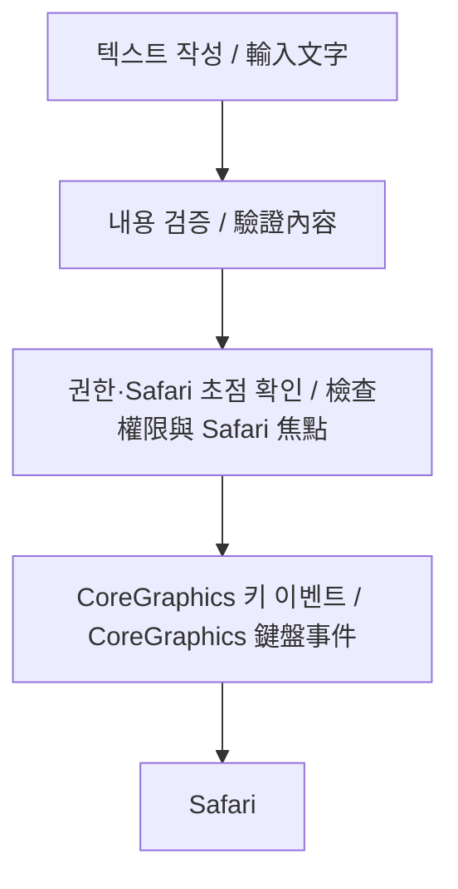

<h1 align="center">유계연</h1>

  대만에서 Swift와 SwiftUI로 도구를 만드는 한국 엔지니어 
  居住於台灣、以 Swift 與 SwiftUI 打造工具的韓國工程師

  macOS · iOS · 개발자 도구 · 미디어 워크플로 
  原生應用 · 開發工具 · 媒體工作流程

  

---

### 소개 · 關於我

작고 성가신 문제를 믿고 쓸 수 있는 도구로 바꾸는 일을 좋아합니다. 기능을 만드는 것만큼 권한, 초점, 예외 상황, 그리고 사용자가 다음에 무엇을 기대할지 분명하게 다루는 것도 중요하게 생각합니다.

我喜歡把小而惱人的問題做成可靠工具。除了功能本身，也在意權限、焦點、例外情況，以及使用者接下來會看到什麼。

### 관심 분야 · 技術興趣

| 분야 | 關注方向 |
| --- | --- |
| **네이티브 Apple 앱** — Swift, SwiftUI, macOS, iOS | **原生 Apple 應用** — Swift、SwiftUI、macOS、iOS |
| **시스템과의 상호작용** — Unicode 입력, 접근성 권한, 포커스, CoreGraphics 이벤트 | **系統互動** — Unicode 輸入、輔助使用權限、焦點、CoreGraphics 事件 |
| **창작 도구** — 미디어 워크플로, 애니메이션 에셋, 실용적인 QA | **創作工具** — 媒體流程、動畫素材、實用的品質檢查 |

### 공개 작업 · 精選作品

#### [TextInjector](https://github.com/gyeyeon385/TextInjector) · macOS 입력 도구

Safari에 Unicode 키보드 이벤트를 보내는 네이티브 SwiftUI 도구입니다. 공백, 여러 줄, Return, Tab 입력을 다루며 권한과 Safari 포커스를 명시적으로 확인합니다.

原生 macOS SwiftUI 工具，透過鍵盤事件將 Unicode 文字輸入 Safari。支援空格、多行文字、Return 與 Tab，並明確檢查權限與 Safari 焦點。

- **구현 포인트:** 클립보드 붙여넣기나 DOM 조작을 사용하지 않습니다. 입력 내용은 로그나 기록으로 남기지 않고 메모리에만 둡니다.
- **검증:** 핵심 테스트 24개가 포함되어 있으며, Safari 실기기 확인 결과와 Apple Silicon·Intel용 Release 빌드가 기록되어 있습니다. v0.2.0은 미리보기 버전입니다.
- **實作重點：** 不使用剪貼簿貼上或操作網頁 DOM。輸入內容不寫入日誌或歷史紀錄，只保留在記憶體中。
- **驗證紀錄：** 專案包含 24 項核心測試、Safari 實機檢查紀錄，以及 Apple Silicon／Intel Release 建置。v0.2.0 為預覽版。

[저장소 · 專案](https://github.com/gyeyeon385/TextInjector) · [검증 기록 · 驗證紀錄](https://github.com/gyeyeon385/TextInjector/blob/main/docs/VALIDATION-0.2.0.md)

#### [DeepSeek Fatfish · Juvenile](https://github.com/gyeyeon385/deepseek-fatfish-juvenile-pet) · 애니메이션 에셋 작업

9가지 표준 동작과 16개 시선 방향으로 구성한 애니메이션 에셋 작업입니다. 192 × 208 픽셀 프레임을 사용한 1536 × 2288 픽셀 스프라이트 시트와 QA 보고서, 제작 기록을 담았습니다.

動畫素材作品，包含 9 種標準動作與 16 個注視方向。精靈表為 1536 × 2288 像素，由 192 × 208 像素單格組成，並附有品質檢查報告與製作紀錄。

<picture>
  <source media="(prefers-color-scheme: dark)" srcset="https://raw.githubusercontent.com/gyeyeon385/gyeyeon385/main/assets/animation-coverage-dark.svg">
  <source media="(prefers-color-scheme: light)" srcset="https://raw.githubusercontent.com/gyeyeon385/gyeyeon385/main/assets/animation-coverage-light.svg">
  
</picture>

소재 출처와 재배포 권한을 확인 중이라는 점은 저장소에 기록했습니다. 그래서 이 프로필에는 캐릭터 원화를 직접 넣지 않고, 구조를 설명하는 도식을 사용했습니다.

素材來源與再散布權限仍在確認中，狀態已記錄於專案內。因此這份個人頁使用結構示意圖，不直接嵌入角色原圖。

[프로젝트 · 專案](https://github.com/gyeyeon385/deepseek-fatfish-juvenile-pet) · [작업 기록 · 製作紀錄](https://github.com/gyeyeon385/deepseek-fatfish-juvenile-pet/blob/main/docs/WORKLOG.md) · [소재·라이선스 상태 · 素材與授權狀態](https://github.com/gyeyeon385/deepseek-fatfish-juvenile-pet/blob/main/LICENSE_STATUS.md)

### TextInjector 입력 흐름 · 輸入流程

### 작업 방식 · 工作方式

- **경계를 명확하게:** 도구가 할 수 있는 일, 필요한 권한, 대상 앱에 따라 달라지는 동작을 구분해 설명합니다.
- **실제 맥락에서 검증:** 빌드 성공만으로 끝내지 않고, 실제 대상 앱과 테스트 페이지에서 경계 사례를 확인합니다.
- **결과를 기록:** 테스트 결과와 아직 확인하지 못한 부분을 프로젝트 문서에 함께 남깁니다.

- **說清楚邊界：** 區分工具能做什麼、需要哪些權限，以及哪些行為仍取決於目標應用程式。
- **在實際情境驗證：** 不只確認能否建置，也會用真實目標 App 與測試頁檢查邊界案例。
- **留下可核對的紀錄：** 在專案文件中一併記下測試結果與尚未確認的部分。

---

[GitHub · gyeyeon385](https://github.com/gyeyeon385)
